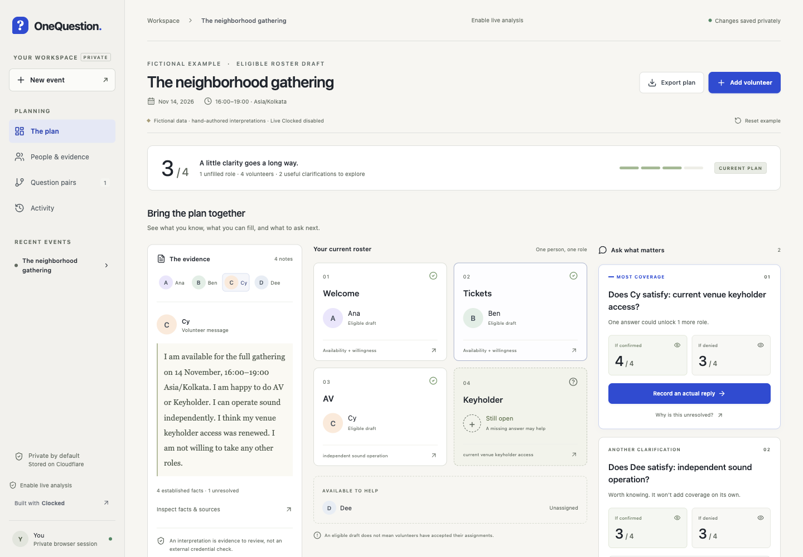

# OneQuestion

Find the missing answer that could complete a volunteer roster, and see exactly how assignments would change.

OneQuestion is a planning workbench for coordinators of small events. Original volunteer messages stay beside reviewed facts. An exact matching engine fills the roles that the evidence supports, then computes both outcomes of a clarification. A hypothetical preview never changes the saved facts.



Watch the [product demo](https://onequestion.tbud.workers.dev/demo/), try the [hosted app](https://onequestion.tbud.workers.dev), or run it locally. The hosted example and manual planning need no account or provider credits. [Hosting and privacy details](docs/DEPLOYMENT.md).

## Judge path

1. [Watch the 93-second video](https://onequestion.tbud.workers.dev/demo/#demo-video).
2. [Try the keyless four-person example](https://onequestion.tbud.workers.dev): its starting interpretations are hand-authored fictional fixtures.
3. [Open the Recorded 9 Nov Clocked review](https://onequestion.tbud.workers.dev/recorded-review/): saved real Fill/Extract/Decide proposals, exact source anchors, the conservative conditional label and the actual review screenshot. This static view makes no new Clocked request.
4. Optionally, run locally and [configure your own Clocked key](#clocked-integration).

The first three steps need no account or key. Anonymous provider analysis is rejected; no shared owner access code is published. The recorded results are not the hand-authored example and are not a broad accuracy benchmark.

## Run locally

Requires **Node.js 22.13 or newer** (tested with 22.14.0) and npm. Node's built-in SQLite API is experimental on Node 22 and may emit a warning.

```sh
npm ci
npm run dev
```

Open **http://127.0.0.1:4317**. Click **Try the four-person example**. No account, API key, paid service, or network call to Clocked is needed for this example.

1. The current draft fills three of four roles: Ana at Welcome, Ben at Tickets, Cy at AV. Dee is unassigned.
2. Preview confirmation of Cy's keyholder access. Four roles become fillable; three existing volunteers change roles.
3. Return to the current plan. It still has three filled roles.
4. Record a fictional actual reply, with a reviewer and a reason. The saved roster now fills four roles.
5. Reload: the reply survives. Review the fact as unknown, or reset the example, to return to three.

The example's messages and interpretations are **hand-authored fictional fixtures**, not saved or simulated Clocked responses. Roster calculations, persistence, imports and exports are real local behavior.

For a production-mode local run:

```sh
npm run build
npm start
```

The Express app binds only to loopback and is intended for a trusted single-user Mac. The hosted version uses a separate Cloudflare Worker with private browser sessions and D1 storage.

## Plan your own event

Create an event with an explicit date, IANA timezone and same-day time interval. Add each individual role, any qualification, and whether coordinator approval is required. For a role needing two people, create two individual slots. Review every requirement before creating the workspace.

Add volunteers and paste their original messages. You can also import a JSON array of `{ "name": "Ana", "text": "Original message" }` objects, or UTF-8 CSV with **name,text** headers. Quoted commas and newlines are supported. Files are limited to 200 KB; each pasted message to 8,000 characters.

In **People & evidence**, review availability, role willingness, qualification and approval separately. Only reviewed affirmative facts enable assignments. Manual corrections and replies require a reviewer and reason. Unknown, conditional, conflicting and unreviewed facts do not establish eligibility. Adding a new source invalidates that person's prior reviews so contradictory information is not silently ignored.

The supported planning model is one shared interval, at most 12 volunteers and 8 simultaneous slots, with at most one slot per person. Single-question analysis is bounded to 10 eligible candidate facts; the UI discloses when more exist. All pairs of those candidates are evaluated, including all four answer branches. Recurring shifts, overlapping intervals, travel, cross-person dependencies and attendance prediction are unsupported.

## Clocked integration

The optional integration uses the official **clocked-sdk 0.7.0**, with its documented schemas:

| Endpoint | Purpose | Effect in OneQuestion |
| --- | --- | --- |
| Fill | Extract role names and explicit requirements from the organizer brief; flag unsupported constraints | Proposes editable role slots and requirements for coordinator review |
| Extract | Find exact source phrases for person-specific prerequisites | Produces verifiable evidence anchors; invalid spans cannot support affirmative approval |
| Decide | Classify each prerequisite as yes, no, unknown, conditional or conflict | Proposes facts that remain ineligible until reviewed |
| Protect / Verify | Not used | No provider redaction or grounding claim |

Fill does not automatically map extracted qualifications to roles or expand capacities. The coordinator explicitly reviews that mapping. Coordinator approval is always manual. A high classification confidence never becomes a probability of a human's future answer.

Live calls are **disabled in a fresh checkout**. This Mac has an authorized private configuration using free credits only. To enable another installation after authorizing provider-credit use, set `CLOCKED_API_KEY` and `CLOCKED_ENABLED=true` in the server environment and restart. Do not put the key in frontend code. The run scripts automatically load a local `.env` when present. To configure another installation, copy `.env.example` to `.env` and fill it privately. An explicit equivalent command is:

```sh
node --env-file=.env --import tsx server/index.ts
```

On the hosted app, **Enable live analysis** accepts a private owner access code for one hour. Public visitors cannot spend the shared Clocked credits. The hosted Worker reserves at most **six provider requests per UTC day**, shared across owner sessions, including failed attempts. Local server limits below are separate.

Each **Analyze with Clocked** action makes at most two provider requests, sequentially: Extract then Decide. Brief compilation makes one Fill request. Requests have a 60-second per-call timeout and a single attempt; SDK idempotency keys are retained within each call. The server allows one analysis at a time and 40 analysis actions per process. These limits bound requests, **not money**; provider credit usage varies with input and model execution time. No automatic retry or background analysis is performed. A manually repeated failed action may use another idempotency key and consume further credits. Canceling the browser interaction does not cancel provider work already accepted.

Source snapshots sent to Clocked include the selected person's messages plus event requirements. They are private data sent to Clocked when live analysis is invoked. Opening the fictional example, manual review, previews, matching, CSV export and pair analysis send no messages to Clocked. Explicitly invoking live analysis on an example does send its fictional sources. A failed or stale analysis leaves the saved workspace unchanged and reports an error. Proposals require fresh review. Recorded 9 Nov outputs are inspectable inside the four-person example and in the [recorded review](https://onequestion.tbud.workers.dev/recorded-review/), with exact quotes, the unchanged conditional result and validation links. These are real saved outputs on fictional inputs; opening them makes no provider call. See [validation history](docs/VALIDATION_HISTORY.md) for the individual runs and their limits.

Official references checked November 9, 2026: [Fill](https://clocked.rezolve.ai/docs/fill), [Extract](https://clocked.rezolve.ai/docs/extract), [Decide](https://clocked.rezolve.ai/docs/decide), [quickstart](https://clocked.rezolve.ai/docs/quickstart). Automated adapter regression tests use synthetic HTTP responses. The separate live evidence above identifies what was actually called.

## Evidence and persistence

Reviewed facts and hypothetical previews remain separate. Hosted workspaces are private to a browser session; export a private backup for recovery. Roster CSV omits source messages. [Storage, evidence, export and matching details](docs/EVIDENCE_AND_PERSISTENCE.md).

## Verification

```sh
npm test
npm run build
npm audit
```

Tests cover the canonical reassignment, conditional and approval gates, a two-answer dependency, Unicode spans, CSV parsing and injection protection, schema errors, 400 reproducible small graphs compared with exhaustive enumeration, and the real HTTP entry point with SQLite restart persistence, stale saves, origin protection and untrusted imports. A real local Cloudflare Worker + D1 test also checks visitor isolation, owner access, workspace limits and oversized requests. Clocked adapter tests use synthetic responses. GitHub Actions is configured, but the first hosted CI run could not start because GitHub reported an account billing lock. The local checks above passed; no hosted CI pass is claimed. See [BUILD_CHECKLIST.md](BUILD_CHECKLIST.md) for actual check status and [docs/SUBMISSION.md](docs/SUBMISSION.md) for the prepared demo and submission copy.

## Architecture and limits

React + Vite render the workbench. Express owns local validation, the official Clocked SDK and SQLite. The hosted Worker reuses the validation and adapter modules, scopes D1 queries to a session owner, and keeps provider secrets server-side. `src/domain.ts` is the pure min-cost maximum matching and question engine; the same module supports local browser previews. No third-party optimizer or agent framework is required. Hosted plan and question calculations run in the browser to keep Worker CPU bounded.

There is no user-account login, collaboration, automatic backup export, auto-messaging, calendar integration or external credential verification. Protect and Verify were deferred to finish the core three-endpoint journey; the roster export minimizes fields locally and makes no redaction or model-grounding claim. There is no independent-user usability study or broad/repeated semantic benchmark. The app is published for a bounded hackathon demo; production readiness is not established. A recorded demo is available. The Clocked Build Challenge entry was submitted November 9 and updated November 10; [the saved-entry receipt](docs/SUBMISSION_RECEIPT.json) confirms submission, not eligibility or an award.

## Troubleshooting

- **Port in use:** set `PORT=4318 npm run dev` and open the corresponding loopback URL. The same-origin guard follows that port.
- **Clocked button disabled:** locally, restart with both required variables set. Hosted, use **Enable live analysis** with the private owner code. Keys never go in browser storage.
- **No questions:** review incomplete prerequisites first. Conflicts and unreviewed facts require a coordinator, and questions with more than two missing prerequisites on a connection are outside the bounded opportunity search.
- **Stale edit:** reload the workspace after another tab changes it.
- **Reset:** restores only the fictional workspace. It does not alter other events.
- **No roster:** check full-interval availability and role willingness independently; qualifications alone do not establish availability.

Third-party dependencies retain their own licenses in their installed packages.
